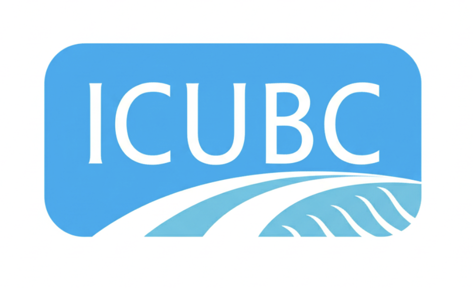
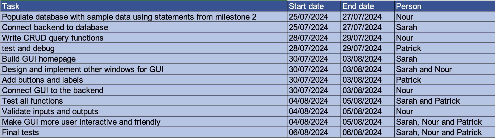

# CPSC304 Project

Citation: created using Gemini AI

### Brief Summary of Project
Our application is for insurance management. The application keeps track of policy holders, policy providers, policies, agents, policy holders, claims, and payments. Our application is focused on vehicle accident claims but it supports two policy types (car and health) so we can have a comprehensive system to keep record of all the various insurance policies and claims.

### Timeline

Our prosed timeline and task division 

We have currently started on the gui and created some panels and a simple homescreen layout. We still have to add in the forms for filing a claim, adding a new vehicle, etc (so basically adding functionality to the buttons). Apart from the gui, we still have not set up or link the database to the front end, so we have to work on the back end and link the two ends together as well. 

No extra information.
